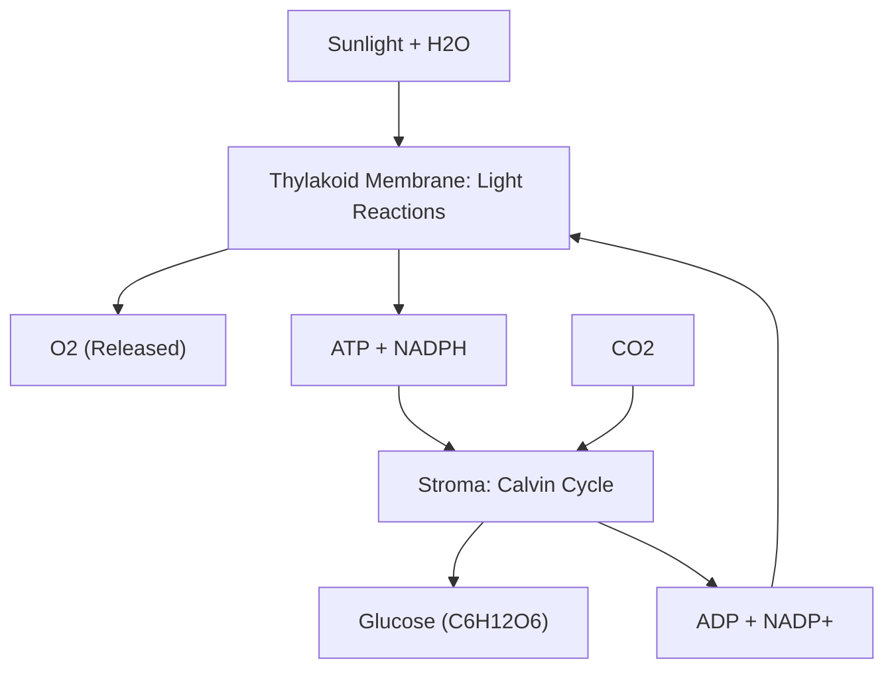
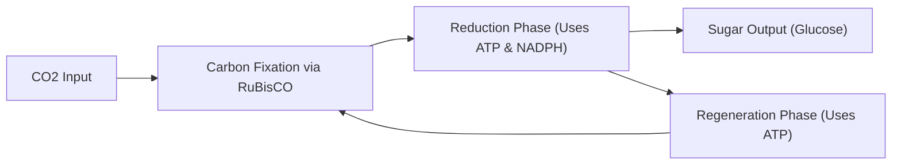

## Slide 1: Introduction to Photosynthesis
**Key points:**
- Photosynthesis is the primary biological process converting light energy into chemical energy [S1].
- It sustains plant life and serves as the foundational energy source for nearly all Earth ecosystems [S1].
- The primary site of photosynthesis in eukaryotic cells is the chloroplast [S1].
- The process takes simple inorganic inputs (water and carbon dioxide) to produce organic sugars [S1].
- Oxygen is released as a vital byproduct of this metabolic pathway [S1].
**Visual:** A detailed 3D diagram showing a plant cell containing green chloroplasts surrounded by light rays.
[IMAGE: plant cell chloroplast structure light energy]
**Speaker notes:**
Welcome everyone to today's biology lecture. Today, we are diving deep into photosynthesis, the essential biochemical engine of our planet. As Class 11 biology students, you'll learn that this process isn't just about plants making food—it's a sophisticated energy conversion mechanism. By the end of this deck, you will understand the exact organelle structures and chemical pathways involved.

---

## Slide 2: Agenda
**Key points:**
- Overview of chloroplast ultrastructure and functional compartments [S1].
- Mechanisms of the Light-Dependent Reactions in the thylakoid membranes [S1].
- Photolysis of water, oxygen release, and energy carrier synthesis [S1].
- Mechanistic breakdown of the Light-Independent Reactions (Calvin Cycle) [S1].
- Enzymatic carbon fixation by RuBisCO in the chloroplast stroma [S1].
- Summary, worked biochemical example, and discussion questions [S1].
**Visual:** An organized table listing the six main agenda topics along with estimated timing for each section.
[IMAGE: classroom presentation agenda structure biology]
**Speaker notes:**
Here is our roadmap for today's session. We will start by reviewing the anatomy of the chloroplast, which dictates where each reaction takes place. Then, we will split our study into the two primary phases of photosynthesis: the light-dependent reactions and the light-independent Calvin cycle. Finally, we will trace the complete flow of molecules in a worked example before opening the floor for discussion.

---

## Slide 3: Learning Objectives
**Key points:**
- Identify the structural components of chloroplasts, including thylakoids and stroma [S1].
- Explain how light energy drives the splitting of water and generation of oxygen [S1].
- Define the roles of ATP and NADPH as high-energy chemical intermediate molecules [S1].
- Trace carbon dioxide fixation into glucose within the Calvin cycle [S1].
- Describe the key role of the enzyme RuBisCO in carbon fixation [S1].
**Visual:** A target icon surrounded by five distinct text boxes listing the learning goals.
[IMAGE: learning objectives science education target icons]
**Speaker notes:**
These objectives outline what you should master by the end of this presentation. Pay special attention to the compartmentalization of these reactions—knowing where each step happens is critical for exams. You will also need to know the specific inputs, outputs, and enzyme catalysts involved in both phases. Let's make sure we hit each of these targets today.

---

## Slide 4: Chloroplast Architecture
**Key points:**
- Chloroplasts are specialized double-membrane organelles responsible for photosynthesis [S1].
- Thylakoids are flattened membrane-bound sacs stacked into structures called grana [S1].
- Thylakoid membranes contain photopigments and protein complexes for light absorption [S1].
- The stroma is the dense fluid-filled space surrounding the thylakoid network [S1].
- Compartmentalization allows distinct biochemical microenvironments for different reaction steps [S1].
**Visual:** High-resolution cross-section diagram of a chloroplast showing thylakoids, grana, stroma, and membranes.
[IMAGE: chloroplast ultrastructure labeled thylakoid stroma diagram]
**Speaker notes:**
To understand photosynthesis, we must first understand the architecture of the chloroplast. Structure dictates function here. Notice how the internal space is partitioned: we have the fluid stroma surrounding stackable membrane discs called thylakoids. As we will see on the next slides, the thylakoid membranes host light absorption, while the fluid stroma hosts chemical synthesis.

---

## Slide 5: Overview of Photosynthetic Reactions
**Key points:**
- Photosynthesis operates via two interconnected biochemical stages [S1].
- Stage 1: Light-dependent reactions convert solar energy into chemical energy [S1].
- Stage 2: Light-independent reactions (Calvin cycle) synthesize organic molecules [S1].
- The products of the light reactions directly fuel the enzymatic steps of the Calvin cycle [S1].
- The two stages cycle energy carriers (ATP/ADP and NADPH/NADP+) continuously [S1].
**Visual:** A conceptual flowchart showing sunlight and water entering light reactions, feeding chemical energy into the Calvin cycle, which takes in carbon dioxide and outputs glucose.

**Speaker notes:**
This diagram provides a high-level conceptual map of the whole photosynthetic process. Notice the two main compartments and how they communicate. Light and water enter the thylakoids, releasing oxygen and charging up ATP and NADPH. Those energy carriers travel to the stroma to power the Calvin cycle, which locks down carbon dioxide into sugar.

---

## Slide 6: Light-Dependent Reactions
**Key points:**
- Occur exclusively within the thylakoid membranes of the chloroplast [S1].
- Absorbed photon energy excites electrons within photosystem pigment complexes [S1].
- Water molecules (H2O) undergo photolysis, splitting to replace excited electrons [S1].
- Splitting water releases molecular oxygen (O2) into the atmosphere as a byproduct [S1].
- The photolytic process and electron transport generate both ATP and NADPH [S1].
**Visual:** Detailed diagram of the thylakoid membrane showing electron transport chain complexes, photon impact, and water splitting.
[IMAGE: light dependent reactions thylakoid electron transport chain]
**Speaker notes:**
Now let's zoom in on the light-dependent reactions taking place inside the thylakoid membranes. When photons strike the light-harvesting complexes, they excite electrons to higher energy levels. To replace lost electrons, an enzyme splits water molecules right inside the thylakoid membrane. This photolysis reaction generates the oxygen gas that we breathe while charging up chemical energy.

---

## Slide 7: Energy Carriers: ATP and NADPH
**Key points:**
- ATP (Adenosine Triphosphate) acts as the cellular energy currency created during light reactions [S1].
- NADPH (Nicotinamide Adenine Dinucleotide Phosphate) functions as a powerful reducing agent [S1].
- Both molecules store high-energy chemical bonds synthesized in thylakoid membranes [S1].
- They exit the thylakoids and diffuse into the surrounding fluid stroma [S1].
- Without ATP and NADPH from the light reactions, carbon fixation cannot occur [S1].
**Visual:** Molecular models of ATP and NADPH alongside an illustration showing their movement from thylakoid to stroma.
[IMAGE: ATP and NADPH molecular structure cellular energy]
**Speaker notes:**
Think of ATP and NADPH as rechargeable batteries loaded up by solar energy. ATP provides the necessary thermodynamic energy to drive chemical reactions, while NADPH provides high-energy electrons needed to reduce carbon molecules. Both of these molecules diffuse out of the thylakoid membranes and into the surrounding stroma to drive the next stage.

---

## Slide 8: Light-Independent Reactions (The Calvin Cycle)
**Key points:**
- Takes place within the fluid stroma of the chloroplast [S1].
- Does not directly require light photons, but depends on light reaction products [S1].
- Incorporates inorganic carbon dioxide (CO2) into organic carbohydrate structures [S1].
- Consumes the ATP and NADPH generated by the light-dependent reactions [S1].
- Catalyzed primarily by the enzyme RuBisCO (Ribulose-1,5-bisphosphate carboxylase-oxygenase) [S1].
- The end product of carbon fixation is ultimately converted into glucose [S1].
**Visual:** A step-by-step molecular pathway diagram of the Calvin cycle in the stroma showing RuBisCO activation.

**Speaker notes:**
Moving into the stroma, we enter the Calvin cycle, also known as the light-independent reactions. Here, inorganic carbon dioxide gas is incorporated into organic matter. This process requires significant energy and reducing power, which is provided by the ATP and NADPH built in the thylakoids. Central to this entire cycle is RuBisCO, one of the most abundant enzymes on Earth.

---

## Slide 9: Worked Example: Tracing Inputs and Outputs
**Key points:**
- Input 1: Water (H2O) is split in thylakoids -> Outputs Oxygen (O2), protons, electrons [S1].
- Input 2: Light energy powers photolysis and generates ATP + NADPH [S1].
- Input 3: Carbon dioxide (CO2) enters the stroma and is fixed by RuBisCO [S1].
- Energy usage: ATP and NADPH drive the conversion of fixed carbon into glucose [S1].
- Final Net Summary: 6 CO2 + 6 H2O + Light -> Glucose (C6H12O6) + 6 O2 [S1].
**Visual:** A balanced quantitative biochemical summary table comparing input molecules, localized reaction sites, required enzymes/carriers, and output products.
[IMAGE: photosynthesis chemical equation input output infographic]
**Speaker notes:**
Let's trace a concrete worked example by following incoming reactants to their final outputs. Imagine 6 molecules of water entering the thylakoid membrane—they are split by light energy, releasing 6 oxygen molecules while creating ATP and NADPH. Meanwhile, 6 molecules of carbon dioxide enter the stroma, where RuBisCO fixes them using that newly produced ATP and NADPH to construct one glucose molecule.

---

## Slide 10: Summary and Discussion
**Key points:**
- Photosynthesis occurs in chloroplasts, segregated into light reactions and the Calvin cycle [S1].
- Thylakoids host light-dependent reactions: photolysis splits H2O, producing O2, ATP, and NADPH [S1].
- Stroma hosts the Calvin cycle: RuBisCO fixes CO2 into glucose using ATP and NADPH [S1].
- Key review question 1: What would happen to Calvin cycle output if thylakoid membranes were damaged?
- Key review question 2: Why is the enzyme RuBisCO essential for terrestrial carbon life?
**Visual:** Summary mind map connecting Chloroplast Anatomy, Light Reactions, Calvin Cycle, and Global Life Support.
[IMAGE: photosynthesis summary mind map biology study guide]
**Speaker notes:**
To recap: photosynthesis is a two-stage process spatially organized inside the chloroplast. Light reactions in the thylakoids split water, produce oxygen, and charge ATP and NADPH. The Calvin cycle in the stroma uses RuBisCO to fix carbon dioxide into glucose using that chemical energy. Let's now discuss our two review questions to test your conceptual understanding before our next quiz!