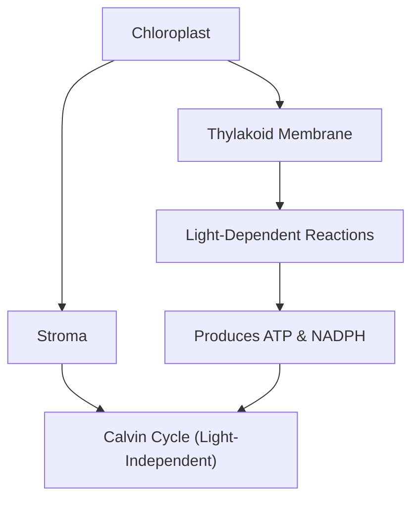
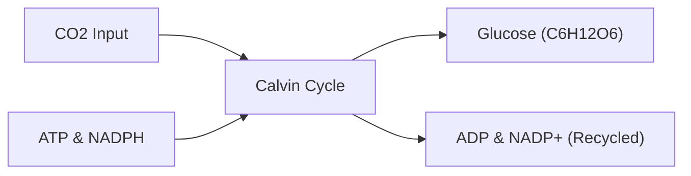

## Slide 1: Introduction to Photosynthesis
**Key points:**
- Photosynthesis is the primary process by which plants, algae, and some bacteria convert light energy into chemical energy [S1].
- This biological process occurs within specialized organelles called chloroplasts found in plant cells [S1].
- The overall reaction transforms carbon dioxide and water into glucose and oxygen using sunlight.
- It provides the foundational energy source for nearly all life forms on Earth.
- The process is divided into two main stages: the light-dependent reactions and the light-independent Calvin cycle [S1].

**Visual:** A high-resolution photograph of a lush green forest with sunlight filtering through the canopy.
[IMAGE: sunlight filtering through forest canopy]

**Speaker notes:**
Welcome everyone to today's session on photosynthesis. Today, we will explore how plants literally "make food from thin air" using the power of the sun. We will look at the specific structures within the leaf that make this possible and break down the complex chemical pathways involved.

---

## Slide 2: Agenda
**Key points:**
- Overview of chloroplast structure and the site of reactions.
- Detailed breakdown of the light-dependent reactions in the thylakoid.
- Analysis of the light-independent reactions, also known as the Calvin cycle.
- The role of key molecules like ATP, NADPH, and the enzyme RuBisCO [S1].
- A worked example of the chemical equation and energy balance.
- Summary of key concepts and a concluding discussion.

**Visual:** A clean, professional list layout showing the progression of the lecture.

**Speaker notes:**
Our roadmap for today starts with the "where" before we move into the "how." We will spend significant time on the two main phases of photosynthesis to ensure you understand how energy is captured and then stored. We will conclude with a practical look at the chemical balancing involved.

---

## Slide 3: Learning Objectives
**Key points:**
- Identify the structural components of the chloroplast and their specific functions [S1].
- Describe the mechanism of water splitting and oxygen release in the thylakoid membranes [S1].
- Explain the production and role of ATP and NADPH as energy carriers [S1].
- Outline the steps of carbon fixation within the stroma via the Calvin cycle [S1].
- Understand the critical role of the enzyme RuBisCO in glucose production [S1].

**Visual:** A focused list of goals for the student to achieve by the end of the presentation.

**Speaker notes:**
By the end of this lesson, you should be able to trace the path of an electron from a water molecule all the way to a sugar molecule. You should also be comfortable identifying which parts of the process happen in the thylakoid versus the stroma. These objectives align with your Class 11 biology curriculum requirements.

---

## Slide 4: The Chloroplast: The Site of Photosynthesis
**Key points:**
- Chloroplasts are double-membrane organelles that house the machinery for photosynthesis [S1].
- The thylakoids are flattened sac-like membranes arranged in stacks called grana.
- The stroma is the fluid-filled space surrounding the thylakoids where the Calvin cycle occurs [S1].
- Chlorophyll pigments embedded in the thylakoid membranes capture light energy.
- The compartmentalization of the chloroplast allows different chemical environments for different reactions.

**Visual:** A detailed diagram showing the outer membrane, inner membrane, stroma, and thylakoid stacks.

**Speaker notes:**
To understand photosynthesis, we must look at the chloroplast. Think of the thylakoids as the solar panels where light is collected, and the stroma as the factory floor where the final product is assembled. This separation is crucial for the efficiency of the plant's energy production.

---

## Slide 5: Light-Dependent Reactions
**Key points:**
- These reactions take place specifically within the thylakoid membranes of the chloroplast [S1].
- Light energy is used to split water molecules (photolysis), which releases oxygen as a byproduct [S1].
- The process generates high-energy electrons that move through an electron transport chain.
- This energy is captured to produce two vital molecules: ATP (adenosine triphosphate) and NADPH [S1].
- These two molecules act as "energy currency" for the next stage of photosynthesis.

**Visual:** A microscopic view of chloroplasts within plant cells showing the green pigment distribution.
[IMAGE: chloroplasts in elodea cells micrograph]

**Speaker notes:**
In the light-dependent phase, the plant captures solar energy. When water is split, oxygen is released into the atmosphere—which is the oxygen we breathe! The real goal for the plant here, however, is to create ATP and NADPH, which carry the energy needed to build sugars later.

---

## Slide 6: The Calvin Cycle: Carbon Fixation
**Key points:**
- The Calvin cycle occurs in the stroma and does not directly require light [S1].
- It utilizes the ATP and NADPH produced during the light-dependent reactions [S1].
- Carbon dioxide (CO₂) is taken from the atmosphere and "fixed" into organic molecules [S1].
- The primary end product of this cycle is glucose, a simple sugar used for energy and growth.
- This cycle must turn multiple times to produce a single molecule of glucose.

**Visual:** A flow chart showing the inputs and outputs of the Calvin cycle.

**Speaker notes:**
Now we move to the stroma for the Calvin cycle. Here, the plant takes inorganic carbon dioxide and turns it into organic sugar. This is a complex cycle that uses the "batteries" (ATP and NADPH) we charged up during the light-dependent reactions.

---

## Slide 7: The Role of RuBisCO
**Key points:**
- RuBisCO (Ribulose-1,5-bisphosphate carboxylase/oxygenase) is the enzyme that catalyzes the first step of the Calvin cycle [S1].
- It is responsible for attaching CO₂ to a five-carbon sugar called RuBP [S1].
- RuBisCO is often cited as the most abundant protein on Earth because it is so essential for life.
- Without this enzyme, the conversion of inorganic carbon to organic matter would be too slow to support life.
- It is a highly regulated enzyme that is sensitive to temperature and gas concentrations.

**Visual:** A 3D molecular model of a large protein enzyme.
[IMAGE: RuBisCO enzyme molecular structure]

**Speaker notes:**
RuBisCO is the "worker" that actually grabs the carbon dioxide. Even though it is quite slow compared to other enzymes, there is so much of it in every green leaf that it gets the job done. It is the bridge between the non-living world of gases and the living world of organic tissue.

---

## Slide 8: Worked Example: The Photosynthesis Equation
**Key points:**
- The balanced chemical equation for photosynthesis is: 6CO₂ + 6H₂O + light energy → C₆H₁₂O₆ + 6O₂.
- Six molecules of carbon dioxide and six molecules of water are required to produce one molecule of glucose.
- The oxygen released (6O₂) comes entirely from the water molecules, not the carbon dioxide.
- This equation represents a redox process where CO₂ is reduced and H₂O is oxidized.
- Energy is stored in the chemical bonds of the glucose molecule (C₆H₁₂O₆).

**Visual:** A clear graphic showing the chemical formula with arrows indicating the source of each atom.
[IMAGE: leaf cross section diagram]

**Speaker notes:**
Let's look at the math. To get one molecule of glucose, the plant needs six molecules of CO₂ and six of water. It's important to remember that the oxygen we breathe out is a "waste product" for the plant, coming specifically from the water it absorbs through its roots.

---

## Slide 9: Recap of Key Concepts
**Key points:**
- Photosynthesis happens in the chloroplast: light reactions in thylakoids, Calvin cycle in stroma [S1].
- Light reactions: Split H₂O, release O₂, and create ATP/NADPH [S1].
- Calvin cycle: Use ATP/NADPH to fix CO₂ into glucose using RuBisCO [S1].
- Energy transformation: Light energy is converted into stable chemical energy in sugars.
- Biological importance: This process supports the food chain and regulates atmospheric oxygen.

**Visual:** A summary table comparing the Light-Dependent and Light-Independent reactions.

**Speaker notes:**
To summarize: we have two stages. The first stage captures energy and breaks water. The second stage uses that energy and RuBisCO to build sugar from carbon dioxide. This elegant system is what keeps the entire biosphere running.

---

## Slide 10: Discussion and Assessment
**Key points:**
- How would a lack of water affect the production of ATP and NADPH?
- Why is the Calvin cycle often called the "dark reactions" even though it usually happens during the day?
- Predict the impact on a plant if the enzyme RuBisCO were to become denatured by high heat.
- Discuss the relationship between the light-dependent and light-independent reactions—can one happen without the other?
- Review: What are the three main inputs and two main outputs of the overall process?

**Visual:** A question mark icon or a simple list of the discussion prompts.

**Speaker notes:**
Let's open the floor for discussion. Think about the dependencies here—if we stop the light, how long can the Calvin cycle continue? Or if the plant's stomata close to save water, how does that affect RuBisCO's ability to fix carbon? I look forward to hearing your thoughts on these connections.