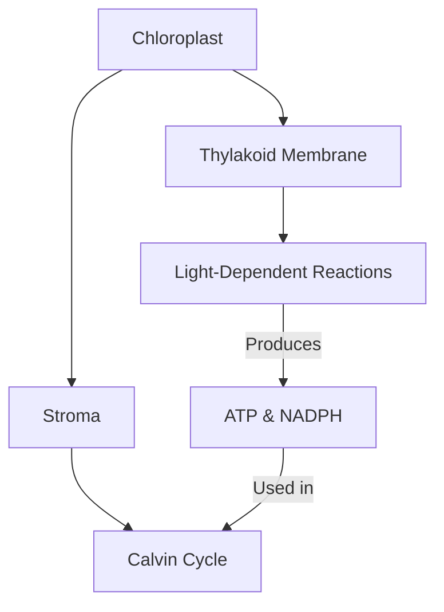
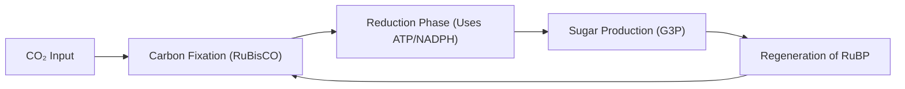

## Slide 1: Introduction to Photosynthesis
**Key points:**
- Photosynthesis is the primary process by which autotrophic organisms convert light energy into chemical energy [S1].
- This biological process occurs within specialized organelles known as chloroplasts found in plant cells [S1].
- The overall reaction involves taking in carbon dioxide and water to produce glucose and oxygen.
- It serves as the foundational energy source for nearly all life forms on Earth.
- The process is divided into two main stages: light-dependent reactions and the Calvin cycle [S1].

**Visual:** A high-resolution micrograph showing several green, oval-shaped chloroplasts within a plant cell.
[IMAGE: chloroplast micrograph under microscope]

**Speaker notes:**
Welcome everyone to our session on Photosynthesis. Today, we will explore how plants transform sunlight into the food that sustains life on our planet. As we see in the image, this complex chemistry happens inside the chloroplasts, which are the "solar panels" of the plant cell.

---

## Slide 2: Agenda
**Key points:**
- Overview of chloroplast structure and its role in energy capture.
- Detailed mechanics of the light-dependent reactions in the thylakoid.
- Analysis of the Calvin cycle and carbon fixation in the stroma.
- The role of key molecules like ATP, NADPH, and the enzyme RuBisCO [S1].
- A worked example of the photosynthetic chemical equation.
- Summary of energy flow and a final knowledge check.

**Visual:** A clean, organized list of topics presented in a logical flow from structure to function.

**Speaker notes:**
Our lecture today follows a specific path. We will start with the "where"—the anatomy of the chloroplast—before moving into the "how"—the light and dark reactions. By the end of this session, you will understand how water and gas are turned into solid sugar.

---

## Slide 3: Learning Objectives
**Key points:**
- Identify the specific locations of the two main stages of photosynthesis within the chloroplast [S1].
- Describe the process of water splitting and oxygen release during light reactions [S1].
- Explain the function of ATP and NADPH as energy carriers between reactions [S1].
- Understand how the enzyme RuBisCO facilitates carbon dioxide fixation [S1].
- Calculate the inputs and outputs required for the synthesis of one glucose molecule.

**Visual:** A bulleted list of goals with a focus on clarity and academic achievement.

**Speaker notes:**
By the end of this class, you should be able to map out the entire photosynthetic pathway. You will need to know the difference between what happens in the thylakoid versus the stroma. We will also focus on the critical role of the enzyme RuBisCO, which is often called the most abundant protein on Earth.

---

## Slide 4: The Chloroplast Structure
**Key points:**
- Chloroplasts are double-membrane organelles containing a fluid called stroma [S1].
- Thylakoids are flattened sac-like structures arranged in stacks called grana.
- The thylakoid membranes contain chlorophyll pigments that absorb light energy.
- Light-dependent reactions are physically localized within these thylakoid membranes [S1].
- The stroma provides the site for the light-independent reactions, or the Calvin cycle [S1].

**Visual:** A detailed diagram showing the outer membrane, inner membrane, stroma, and stacks of thylakoids.

**Speaker notes:**
To understand photosynthesis, we must understand the geography of the chloroplast. Think of the thylakoids as the power station where energy is captured. The stroma is like the factory floor where that energy is used to build products.

---

## Slide 5: Light-Dependent Reactions
**Key points:**
- These reactions require direct sunlight to excite electrons in chlorophyll.
- Water molecules (H₂O) are split in a process called photolysis to replace lost electrons [S1].
- The splitting of water results in the release of oxygen (O₂) as a byproduct [S1].
- Solar energy is converted into chemical energy in the form of ATP and NADPH [S1].
- These energy-rich molecules are then transported to the stroma for the next phase.

**Visual:** A diagram of a thylakoid membrane showing light hitting a photosystem and water splitting into oxygen and protons.
[IMAGE: thylakoid membrane light reaction diagram]

**Speaker notes:**
During the light-dependent reactions, the plant essentially "harvests" the sun. When water is split, it releases the oxygen that we breathe. The main goal here isn't to make sugar yet, but to create the "batteries"—ATP and NADPH—that will power the next stage.

---

## Slide 6: The Calvin Cycle (Light-Independent Reactions)
**Key points:**
- The Calvin cycle takes place in the stroma and does not directly require light [S1].
- It utilizes the ATP and NADPH produced during the light-dependent reactions [S1].
- Carbon dioxide (CO₂) from the atmosphere is "fixed" into organic molecules [S1].
- The process involves a series of enzyme-mediated steps to eventually produce glucose.
- This cycle must turn multiple times to produce a single stable sugar molecule.

**Visual:** A circular flow chart representing the stages of the Calvin cycle: Fixation, Reduction, and Regeneration.

**Speaker notes:**
Now we move to the Calvin cycle in the stroma. Here, the plant takes inorganic carbon dioxide and turns it into organic food. This is a cycle, meaning the starting materials are regenerated at the end so the process can continue indefinitely as long as energy is supplied.

---

## Slide 7: The Role of RuBisCO
**Key points:**
- RuBisCO (Ribulose-1,5-bisphosphate carboxylase/oxygenase) is the enzyme that catalyzes the first step of the Calvin cycle [S1].
- It attaches CO₂ to a five-carbon sugar called RuBP [S1].
- This step is known as carbon fixation because it "fixes" gas into a solid form.
- RuBisCO is relatively slow and inefficient, so plants produce it in massive quantities.
- Without this specific enzyme, life as we know it would not have a way to bring carbon into the food chain.

**Visual:** A 3D molecular model of the RuBisCO enzyme showing its complex protein structure.
[IMAGE: RuBisCO enzyme molecular structure]

**Speaker notes:**
RuBisCO is arguably the most important enzyme on Earth. It is the bridge between the non-living world of gases and the living world of organic matter. Because it is somewhat slow, plants make a lot of it, which is why it makes up a huge percentage of the protein found in leaves.

---

## Slide 8: Worked Example: The Photosynthetic Equation
**Key points:**
- The balanced chemical equation is: 6CO₂ + 6H₂O + Light Energy → C₆H₁₂O₆ + 6O₂.
- To produce 1 molecule of glucose (C₆H₁₂O₆), the plant requires 6 molecules of carbon dioxide.
- 6 molecules of water are split to provide the necessary electrons and protons [S1].
- This process results in 6 molecules of oxygen being released into the atmosphere [S1].
- The energy stored in the bonds of glucose comes originally from the captured photons.

**Visual:** A clear graphic showing the inputs (water, light, CO2) on the left and outputs (glucose, oxygen) on the right.
[IMAGE: photosynthesis chemical equation diagram]

**Speaker notes:**
Let's look at the math of photosynthesis. To get one single molecule of glucose, the plant has to process six molecules of CO2 and six molecules of water. This shows us exactly why plants are so vital—they take our waste product, CO2, and give us back sugar and oxygen.

---

## Slide 9: Recap of Key Concepts
**Key points:**
- Photosynthesis occurs in the chloroplast: light reactions in thylakoids, Calvin cycle in stroma [S1].
- Light reactions split water and release oxygen while creating ATP and NADPH [S1].
- The Calvin cycle uses that ATP and NADPH to fix CO₂ into glucose [S1].
- RuBisCO is the essential enzyme for capturing atmospheric carbon [S1].
- The process converts solar energy into stable chemical energy stored in sugars.

**Visual:** A summary table comparing the Light-Dependent and Light-Independent reactions.

**Speaker notes:**
To summarize: the light reactions are about energy capture and water splitting, while the Calvin cycle is about carbon fixation and sugar building. Remember that the two stages are linked by the energy carriers ATP and NADPH. One cannot function for long without the other.

---

## Slide 10: Discussion and Assessment
**Key points:**
- How would a lack of water affect the production of ATP and NADPH?
- Why is the Calvin cycle often called the "Dark Reactions" even though it usually happens during the day?
- Predict what would happen to a plant if the enzyme RuBisCO was inhibited by a toxin.
- Explain the relationship between the oxygen we breathe and the process of photolysis.
- Discuss how light intensity might change the rate of glucose production.

**Visual:** An image of a healthy green leaf with sunlight filtering through it to stimulate thought.
[IMAGE: green leaf with sunlight]

**Speaker notes:**
Let's open the floor for discussion. Think about the dependencies we discussed. If a plant has no water, the light reactions stop, which means the Calvin cycle runs out of "batteries." How does this explain why plants wilt and die during a drought? I look forward to your insights.